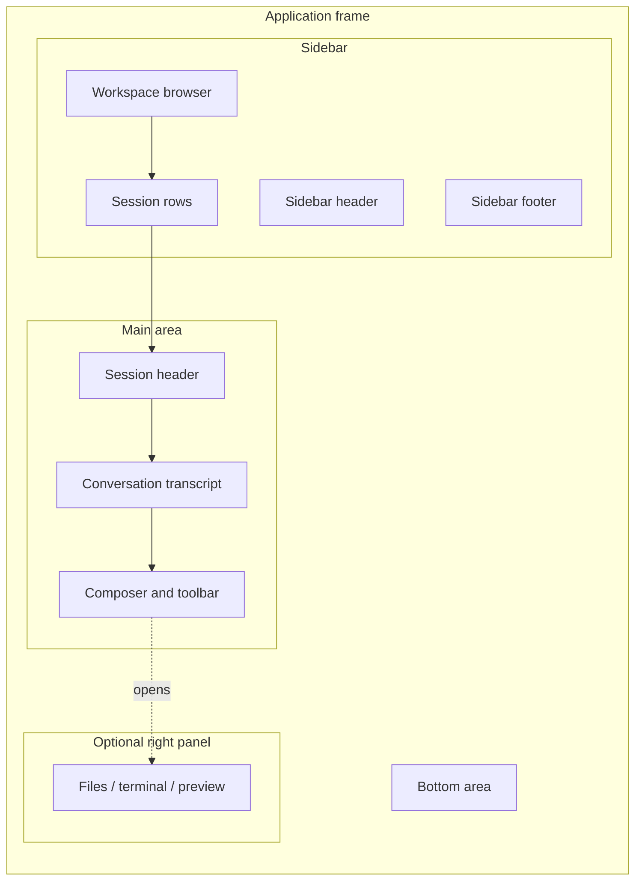

# Web UI interface regions

English | [中文](interface-regions.zh.md)

This reference gives the names used for the visible regions of the DeepSeek Harness Web UI and desktop client. Use these names when describing a screenshot, reporting an issue, or writing a procedure.

## Overall layout

The application frame is a three-column layout. The left sidebar and the optional right panel can be resized or collapsed; the main area keeps the active page or session visible between them.

| UI name | Chinese name | Where it is | What it contains |
| --- | --- | --- | --- |
| Application frame | 应用框架 | The whole client content area | The sidebar, main area, optional right panel, bottom area, and overlays. |
| Window chrome | 窗口区 | The top strip in the desktop client | The operating-system title bar and desktop window controls. It is outside the conversation content. |
| Sidebar | 左侧栏 | The left column | Workspace and session navigation, new-session controls, settings entry, and account controls. |
| Main area | 主区域 | The center column | The selected conversation or another active page such as Settings. |
| Right panel | 右侧栏 | The optional right column | A file browser, terminal, preview, deliverable, or another panel supplied by the active feature. |
| Bottom area | 底部区域 | The bottom edge of the application frame | Global controls or status contributions registered by the client. It can be empty. |
| Overlay layer | 浮层 | Above the application frame | Dialogs, menus, pickers, approval prompts, toasts, and other temporary surfaces. |

The code and plugin APIs use `sidebar`, `main`, `rightbar`, `shell.bottom`, and `shell.overlay` for several of these regions. Those identifiers are implementation names; the Chinese names in this page are the names to use in user-facing instructions.

## Visual tour

The following diagram shows the usual conversation view. A right panel and the bottom area appear only when the active feature contributes them.

### Walk through one request

1. In the **Workspace browser**, select a workspace and then select a **Session row**.
2. In the **Model selector** inside the **Composer**, choose the provider and model.
3. Enter a request in the composer and use its send control.
4. Read the result in the **Conversation transcript**. Tool calls, approvals, and plan entries appear as activity cards in the same region.
5. If the task opens a file, terminal, or preview surface, identify it by the feature name in the **Right panel**.

## Sidebar

The sidebar is the navigation area for workspaces and sessions. Its exact controls depend on the available plugins and on whether the window is wide enough to show the expanded form.

| Sidebar area | Chinese name | Purpose |
| --- | --- | --- |
| Sidebar header | 侧栏头部 | Holds the leading controls, collapse or expand control, and product or account entry points. |
| New session control | 新建会话入口 | Starts a session in the selected workspace. |
| Workspace browser | 工作区浏览器 | Groups projects or directories and exposes the sessions under each workspace. |
| Session row | 会话行 | Opens one session and provides actions such as rename, pin, archive, or delete when available. |
| Sidebar footer | 侧栏底部 | Holds settings, account, help, or other registered controls. |

When the sidebar is collapsed, use **collapsed sidebar**（折叠侧栏）for the compact state. The workspace and session browser is still the same navigation region; only its presentation changes.

## Main area and conversation

The main area shows the active panel. A session uses the following terms:

| Conversation area | Chinese name | Purpose |
| --- | --- | --- |
| Session header | 会话头部 | Identifies the active session and exposes session-level actions. |
| Conversation transcript | 对话记录区 | The scrollable sequence of user, assistant, tool, approval, plan, and status entries. |
| Message or activity card | 消息或活动卡片 | One visible entry in the transcript. Tool calls and process activity can use their own card style. |
| Turn controls | 回合控制区 | Controls attached to a turn, such as retry, feedback, or navigation. |
| Composer | 输入区 | The area used to write and submit the next request. |
| Composer toolbar | 输入区工具栏 | Attachment, command, model, reasoning, and other actions next to the input. |
| Model selector | 模型选择器 | The control and popup used to choose a provider, model, and available reasoning effort. |

If no session is selected, the main area can show a welcome or workspace-selection page instead of a conversation transcript.

## Right panel

The right panel is optional. It is shown when a feature asks the layout to reserve a right-hand track. The panel's title and contents come from that feature, so describe it by the visible feature name when reporting an issue, for example **文件面板**, **终端面板**, or **预览面板**.

The right panel can be resized, collapsed, or made full-screen by the feature that owns it. These states do not change the name of the region.

## Settings and other pages

Settings and plugin pages occupy the main area as an active panel. Within a settings page, use these names:

| Settings area | Chinese name | Purpose |
| --- | --- | --- |
| Settings header | 设置页头部 | Page title, close or back action, and page-level actions. |
| Settings navigation | 设置导航 | The list of settings sections, such as General, Models, Account, or Plugins. |
| Settings content pane | 设置内容区 | The selected section's fields, rows, cards, and explanations. |
| Settings row or card | 设置项或卡片 | One editable preference or one grouped configuration item. |

The model configuration page is therefore the **Settings content pane → Models section**, while a model picker opened from the composer is the **Model selector** in the conversation area.

## Temporary surfaces

Use **overlay**（浮层）as the general term for temporary UI that sits above the current page. Use a more specific name when possible:

- **Dialog**（对话框） for a modal form or confirmation.
- **Menu**（菜单） for an anchored action list.
- **Picker**（选择器） for a searchable selection surface, such as the model picker or workspace picker.
- **Toast**（提示条） for a short-lived notification.
- **Approval prompt**（审批提示） for a request that needs the user's permission before an operation continues.

## Naming guidance

Name the region first and the control second: “在左侧栏的工作区浏览器中打开会话” is clearer than “点击左边列表”。 For a feature-owned right panel, include the feature name because the panel itself is optional. For desktop-only controls, say “窗口区” or “桌面窗口区” so Web UI readers do not look for a browser control that is not present.
