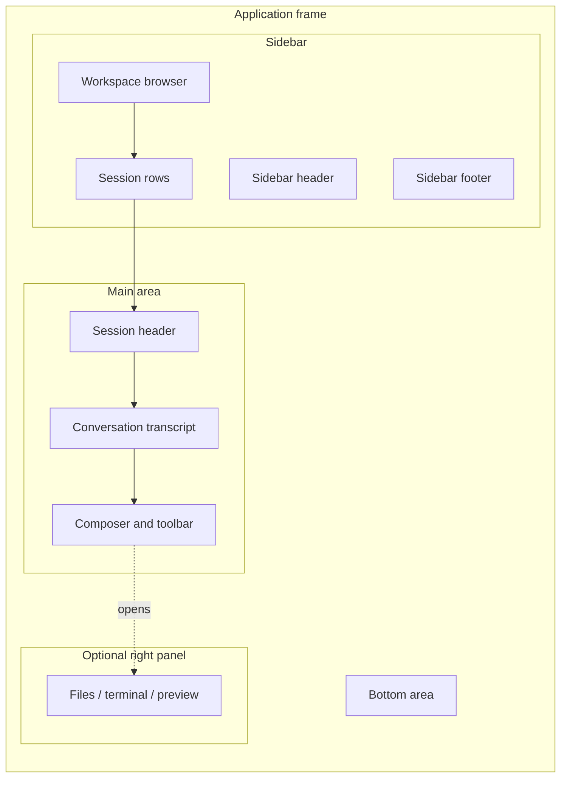

# Web UI 界面区域名称

[English](interface-regions.md) | 中文

本文整理 DeepSeek Harness Web UI 和桌面客户端中可见区域的名称。描述截图、反馈问题或编写操作步骤时，建议使用这些名称。

## 整体布局

应用框架采用三栏布局。左侧栏和可选的右侧栏可以调整宽度或折叠；主区域在两者之间显示当前页面或会话。

| 界面名称 | English | 位置 | 包含内容 |
| --- | --- | --- | --- |
| 应用框架 | Application frame | 客户端内容区域的整体 | 左侧栏、主区域、可选右侧栏、底部区域和浮层。 |
| 窗口区 | Window chrome | 桌面客户端顶部条带 | 操作系统标题栏和桌面窗口控制。它位于会话内容之外。 |
| 左侧栏 | Sidebar | 左侧栏位 | 工作区和会话导航、新建会话入口、设置入口及账号控件。 |
| 主区域 | Main area | 中间栏位 | 当前会话，或设置等其他活动页面。 |
| 右侧栏 | Right panel | 可选的右侧栏位 | 当前功能提供的文件、终端、预览、交付物或其他面板。 |
| 底部区域 | Bottom area | 应用框架底部 | 客户端注册的全局控件或状态信息，也可能为空。 |
| 浮层 | Overlay layer | 应用框架之上 | 对话框、菜单、选择器、审批提示、提示条及其他临时界面。 |

代码和插件 API 对部分区域使用 `sidebar`、`main`、`rightbar`、`shell.bottom` 和 `shell.overlay` 这些标识符。它们是实现名称；面向用户的说明应使用本文的中文名称。

## 图示演示

下面的示意图展示常见的会话页面。右侧栏和底部区域只有在当前功能提供它们时才会显示。

### 演示一次请求

1. 在**工作区浏览器**中选择工作区，再选择一条**会话行**。
2. 在**输入区**中的**模型选择器**里选择提供商和模型。
3. 在输入区填写请求，然后使用发送控件。
4. 在**对话记录区**查看结果。工具调用、审批和计划条目会以活动卡片显示在同一区域。
5. 如果任务打开了文件、终端或预览界面，请在**右侧栏**中使用该功能的具体名称来描述它。

## 左侧栏

左侧栏用于导航工作区和会话。具体控件会随已启用插件以及窗口是否足够宽而变化。

| 左侧栏区域 | English | 用途 |
| --- | --- | --- |
| 侧栏头部 | Sidebar header | 放置前置控件、折叠或展开控件，以及产品或账号入口。 |
| 新建会话入口 | New session control | 在选定工作区中启动会话。 |
| 工作区浏览器 | Workspace browser | 按项目或目录分组，并显示每个工作区下的会话。 |
| 会话行 | Session row | 打开某个会话，并在可用时提供重命名、置顶、归档或删除等操作。 |
| 侧栏底部 | Sidebar footer | 放置设置、账号、帮助或其他已注册控件。 |

左侧栏收起后，称为**折叠侧栏**（collapsed sidebar）。工作区和会话浏览器仍然是同一导航区域，只是显示方式发生变化。

## 主区域和对话

主区域显示当前活动面板。会话中使用以下名称：

| 对话区域 | English | 用途 |
| --- | --- | --- |
| 会话头部 | Session header | 标识当前会话，并提供会话级操作。 |
| 对话记录区 | Conversation transcript | 按顺序显示用户、助手、工具、审批、计划和状态条目。 |
| 消息或活动卡片 | Message or activity card | 记录中的一条可见内容。工具调用和进程活动可以使用独立卡片样式。 |
| 回合控制区 | Turn controls | 附着在某个回合上的重试、反馈或导航等控件。 |
| 输入区 | Composer | 编写并提交下一条请求的区域。 |
| 输入区工具栏 | Composer toolbar | 位于输入框附近的附件、命令、模型、推理等级和其他操作。 |
| 模型选择器 | Model selector | 选择提供商、模型和可用推理等级的控件及弹出层。 |

未选中会话时，主区域可能显示欢迎页或工作区选择页，而不是对话记录区。

## 右侧栏

右侧栏是可选区域。当某个功能要求布局保留右侧栏位时才会显示。右侧栏的标题和内容由该功能决定；反馈问题时，应尽量使用页面上显示的功能名称，例如**文件面板**、**终端面板**或**预览面板**。

右侧栏可以由所属功能调整大小、折叠或切换为全屏。这些状态不会改变该区域的名称。

## 设置和其他页面

设置页和插件页作为活动面板显示在主区域中。设置页内部使用以下名称：

| 设置区域 | English | 用途 |
| --- | --- | --- |
| 设置页头部 | Settings header | 页面标题、关闭或返回操作，以及页面级操作。 |
| 设置导航 | Settings navigation | 设置分区列表，例如常规、模型、账号或插件。 |
| 设置内容区 | Settings content pane | 当前分区的字段、行、卡片和说明。 |
| 设置项或卡片 | Settings row or card | 一个可编辑偏好，或一组配置项。 |

因此，模型配置页面可以称为**设置内容区 → 模型分区**；从输入区打开的模型弹出层则称为对话区域中的**模型选择器**。

## 临时界面

对于覆盖当前页面的临时界面，使用**浮层**作为通用名称。可以使用更具体的名称：

- **对话框**（Dialog）：模态表单或确认窗口。
- **菜单**（Menu）：锚定在控件旁的操作列表。
- **选择器**（Picker）：可搜索的选择界面，例如模型选择器或工作区选择器。
- **提示条**（Toast）：短时间显示的通知。
- **审批提示**（Approval prompt）：操作继续前需要用户授权的提示。

## 命名建议

先说区域，再说控件：“在左侧栏的工作区浏览器中打开会话”比“点击左边列表”更清楚。对于由功能提供的右侧栏，请带上功能名称，因为右侧栏不是固定显示的。桌面专有控件请称为“窗口区”或“桌面窗口区”，避免 Web UI 用户寻找浏览器中不存在的控件。
